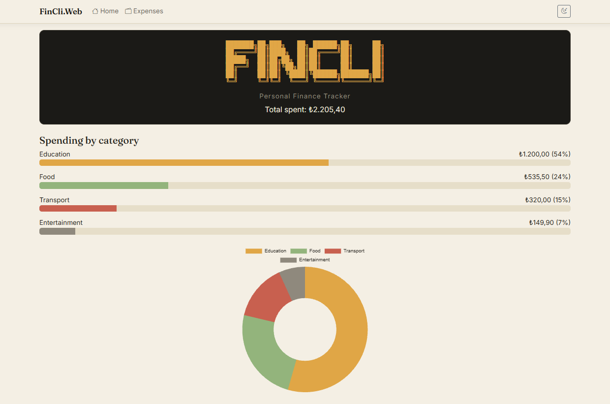
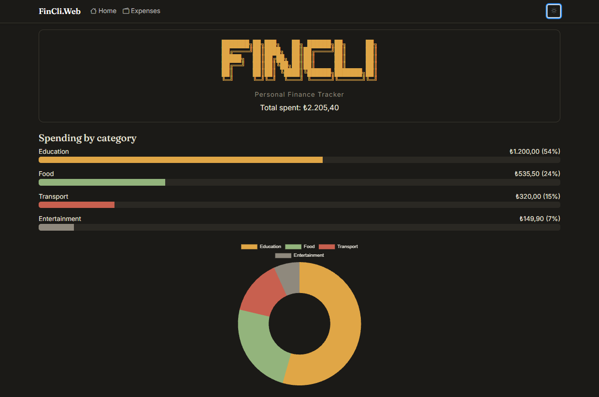
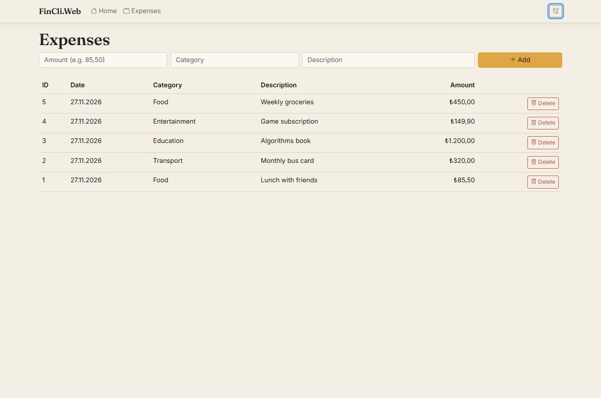

# FinCli

A personal finance tracker built with C# and .NET 10. It runs in the terminal and also has a small web interface.
Add expenses, list them in a table, and see your totals. Data is stored as JSON.


## Features

- Add expenses with amount, category and description
- List all expenses in a styled table
- Show the total and the total of the current month
- Show spending by category as a bar chart
- Data is saved to a JSON file between runs
- Terminal UI built with [Spectre.Console](https://spectreconsole.net/)
- Web interface (ASP.NET Core Razor Pages): list, add and delete expenses, category summary and a doughnut chart
- Light and dark theme in the web interface
- Unit tests with xUnit

## Requirements

- [.NET 10 SDK](https://dotnet.microsoft.com/download)

## Run

```
git clone https://github.com/recefeb/FinCli.git
cd FinCli
dotnet run --project src/FinCli.App
```

## Web interface

The web interface reuses `FinCli.Core`, so it shows the same data as the terminal app.

```
dotnet run --project src/FinCli.Web
```

Then open the address printed in the console (for example `http://localhost:5256`).

> There are no user accounts and the data is a local JSON file, so this is meant to run on your own computer only. Do not expose it to the internet.

| Home (light) | Home (dark) |
| :---: | :---: |
|  |  |



## Test

```
dotnet test
```

## Where is my data?

On Windows, your expenses are saved to `%APPDATA%\FinCli\transactions.json`.
On other systems, .NET chooses the folder (usually `~/.config/FinCli/`).
The terminal app and the web interface use the same file.
This file is outside the repository, so it is never committed.

## Project structure

- `src/FinCli.Core` : models, storage and business logic (LINQ totals)
- `src/FinCli.App` : the terminal interface
- `src/FinCli.Web` : the web interface (ASP.NET Core Razor Pages)
- `tests/FinCli.Tests` : xUnit tests

---

# FinCli (Türkçe)

C# ve .NET 10 ile yazılmış kişisel finans takip aracı. Terminalde çalışır ve küçük bir web arayüzü de vardır.
Harcama ekleyebilir, tablo halinde listeleyebilir ve toplamlarını görebilirsin. Veriler JSON olarak saklanır.

## Özellikler

- Tutar, kategori ve açıklama ile harcama ekleme
- Tüm harcamaları şık bir tabloda listeleme
- Toplam ve içinde bulunulan ayın toplamını gösterme
- Harcamaları kategoriye göre bar grafiğinde gösterme
- Veriler çalıştırmalar arasında JSON dosyasında saklanır
- [Spectre.Console](https://spectreconsole.net/) ile terminal arayüzü
- Web arayüzü (ASP.NET Core Razor Pages): harcama listeleme, ekleme ve silme, kategori özeti ve halka grafik
- Web arayüzünde açık ve koyu tema
- xUnit ile birim testleri

## Gereksinimler

- [.NET 10 SDK](https://dotnet.microsoft.com/download)

## Çalıştırma

```
git clone https://github.com/recefeb/FinCli.git
cd FinCli
dotnet run --project src/FinCli.App
```

## Web arayüzü

Web arayüzü `FinCli.Core` projesini kullanır, bu yüzden terminal uygulamasıyla aynı verileri gösterir.

```
dotnet run --project src/FinCli.Web
```

Sonra konsolda yazan adresi aç (örneğin `http://localhost:5256`). Ekran görüntüleri yukarıdaki İngilizce bölümde.

> Kullanıcı hesabı yoktur ve veriler yerel bir JSON dosyasındadır. Bu yüzden yalnızca kendi bilgisayarında çalıştırmak için tasarlandı. İnternete açma.

## Test

```
dotnet test
```

## Verilerim nerede?

Windows'ta harcamaların `%APPDATA%\FinCli\transactions.json` dosyasına kaydedilir.
Diğer sistemlerde klasörü .NET seçer (genellikle `~/.config/FinCli/`).
Terminal uygulaması ve web arayüzü aynı dosyayı kullanır.
Bu dosya repo dışındadır, bu yüzden commit'e asla girmez.

## Proje yapısı

- `src/FinCli.Core` : modeller, depolama ve iş mantığı (LINQ toplamları)
- `src/FinCli.App` : terminal arayüzü
- `src/FinCli.Web` : web arayüzü (ASP.NET Core Razor Pages)
- `tests/FinCli.Tests` : xUnit testleri
